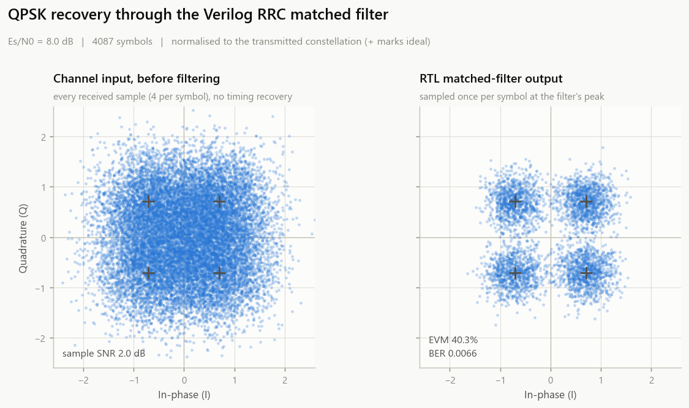
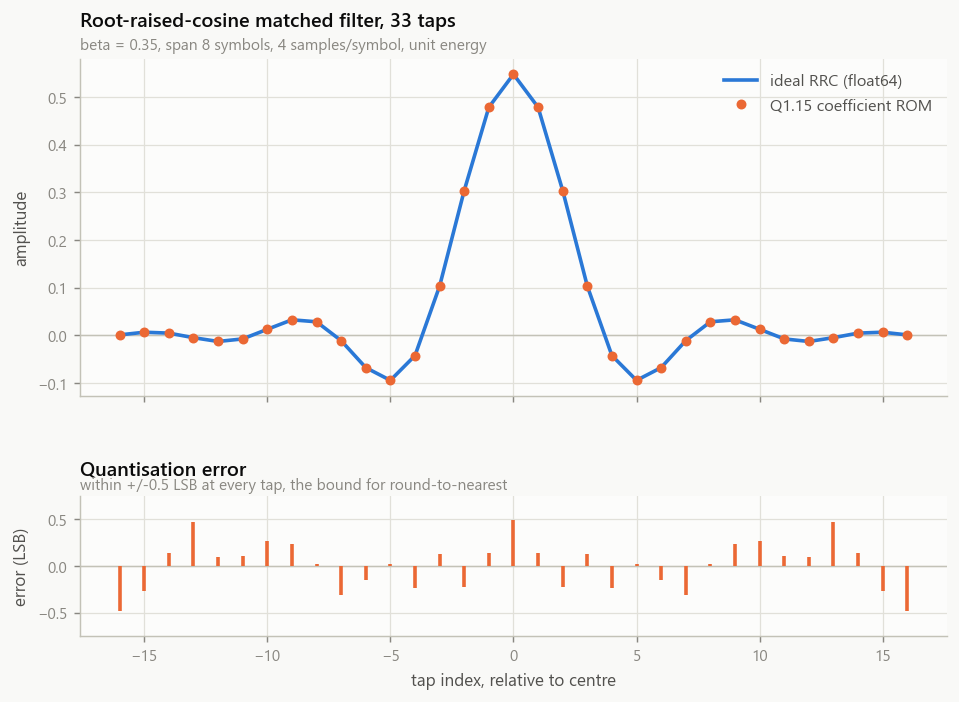
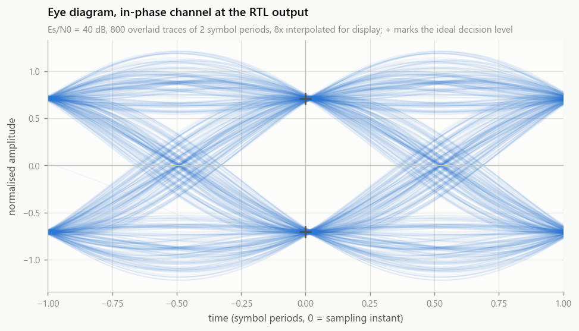

# Lunar-Orbit QPSK Receiver — RRC Matched Filter in Verilog

A 33-tap root-raised-cosine matched filter for a QPSK downlink, built from
**custom pipelined radix-4 Booth multipliers**, wrapped in **AXI4-Stream** with
lossless back-pressure, and verified **bit-exactly** against a Python golden
model on real modulated data.



Left: what arrives on the wire — RRC-shaped QPSK at 4 samples/symbol with a
sample SNR of **+2.0 dB**. Right: the same stream after the Verilog matched
filter, sampled once per symbol. The four clusters are recovered in hardware.

---

## Verified results

Every number below was produced by `./sim/run_sim.sh` on Icarus Verilog 12.0.
Nothing here is estimated.

| Check | Result |
|---|---|
| Booth multiplier vs Verilog `*` | **0 errors / 81,986 comparisons** (all corners, 16-bit sweeps, 50k random) |
| Filter output vs bit-exact golden model | **0 mismatches / 16,384 samples** |
| Data loss under back-pressure | **16,412 beats in → 16,412 out**, 2,894 stall + 2,055 gap cycles |
| Pipeline latency | **12 cycles**, measured, matches the parameterised value |
| X-propagation | X at power-up, cleared by the synchronous reset — asserted at the delay line, Booth pipe, adder tree and master port |
| Saturation coverage | **237 saturating outputs**, all bit-exact (directed corner-case run) |
| Zero-ISI | eye fully open at the sampling instant on a clean channel |
| Link performance | **BER 1.10× theoretical QPSK** (54 bit errors in 8,174 bits at Es/N0 = 8 dB) |
| Matched-filter gain | **+5.20 dB** (EVM 73.3% → 40.3%) |

The BER result is the one that matters: a filter can be bit-exact to its own
model and still be the wrong filter. Landing within 10% of the theoretical QPSK
bound — with the residual well inside the ±14% one-sigma spread of a 54-error
sample — says the implemented response is genuinely matched to the transmit
pulse.

| | |
|---|---|
|  |  |

---

## Architecture

```
                    s_axis_tdata {Q[31:16], I[15:0]}
                                 │
        ┌────────────────────────┴────────────────────────┐
        │              rrc_fir_axis  (AXI4-Stream)        │
        │   pipeline_enable = s_tvalid & m_tready         │
        │   pipe_advance    = m_tready                    │
        │   valid/tlast shift register, LATENCY deep      │
        └───────┬─────────────────────────────────┬───────┘
                │ I                               │ Q
        ┌───────▼───────┐                 ┌───────▼───────┐
        │ rrc_fir_core  │                 │ rrc_fir_core  │
        └───────┬───────┘                 └───────────────┘
                │
   ┌────────────▼─────────────┐
   │ 33-stage delay line      │  gated by sample_en, synchronous reset,
   │ (D flip-flops, no init)  │  X at power-up by design
   └────────────┬─────────────┘
                │ 33 taps
   ┌────────────▼─────────────┐   ┌──────────────────┐
   │ 33 × booth_mult_r4       │◄──┤ rrc_coeff_rom    │ $readmemh or case
   │ radix-4 Booth, 4 stages  │   │ 33 × Q1.15       │
   └────────────┬─────────────┘   └──────────────────┘
                │ 33 × 32-bit products
   ┌────────────▼─────────────┐
   │ pipelined_adder_tree     │  33→17→9→5→3→2→1, one add per stage
   └────────────┬─────────────┘
                │ 38-bit accumulator
   ┌────────────▼─────────────┐
   │ round half up → saturate │  (acc + 2^14) >>> 15, clamped to Q1.15
   └────────────┬─────────────┘
                ▼  m_axis_tdata
```

### Bit growth

| Stage | Format | Width |
|---|---|---|
| Input sample, coefficient | Q1.15 | 16 |
| Booth product | Q2.30 | 32 |
| Accumulator (33 products) | Q8.30 | 32 + ⌈log₂33⌉ = **38** |
| Output | Q1.15 | 16 |

38 bits is one more than the 37 the worst case needs (33 × 2³⁰ = 2³⁶·⁰⁵), so the
accumulator provably cannot wrap. `golden_model.py` asserts this every run.

### Latency

| Stage | Cycles |
|---|---|
| Delay line | 1 |
| Booth multiplier | 4 |
| Adder tree (⌈log₂33⌉) | 6 |
| Output round/saturate | 1 |
| **Total** | **12** |

The testbench measures the real end-to-end delay and fails if it disagrees with
the parameterised value, so the two cannot drift apart.

---

## Two design decisions worth explaining

**The Booth multiplier pre-computes its multiples.** Radix-4 recoding turns 16
partial products into 8, each one of {0, ±A, ±2A}. The naive build computes
`-A` inside every partial-product stage, putting a negation *and* an adder on
the critical path. Here ±A and ±2A are computed once in S1 and shared by all
eight multiplexers, so each pipeline stage is one 5:1 mux plus one 32-bit add.

**The AXI4-Stream wrapper uses two enables, not one.** The obvious
`pipeline_enable = tvalid & tready` for everything is subtly wrong: when the
source goes idle the whole pipeline freezes, so a beat already presented on the
master port stays valid while the sink keeps TREADY high — and the same sample
is transferred twice. This design advances the *arithmetic* pipeline on TREADY
alone (an idle source injects an invalid bubble that pushes the finished beat
out exactly once) while the *delay line* still moves only on real samples, so
the filter history is never corrupted by a bubble. The testbench proves it:
16,412 beats in, 16,412 out, under randomised stalls and gaps.

---

## Layout

```
python/   gen_stimulus.py     QPSK → RRC → AWGN → Q1.15 → .hex   (Phase 1)
          golden_model.py     bit-exact integer model of the RTL
          analyze_results.py  verify output.hex, measure EVM/BER, plot (Phase 3)
          dsp_common.py       RRC design + fixed-point helpers
          viz_style.py        figure styling

rtl/      rrc_fir_axis.v          AXI4-Stream top level          (Phase 2)
          rrc_fir_core.v          delay line + MACs + tree + round/saturate
          booth_mult_r4.v         pipelined radix-4 Booth multiplier
          pipelined_adder_tree.v  generic balanced adder tree
          rrc_coeff_rom.v         coefficient ROM ($readmemh or case)
          rrc_defs.vh             shared constants

sim/      tb_booth_mult.v     multiplier unit test
          tb_rrc_fir_axis.v   data-in-the-loop testbench
          run_sim.sh          full regression

syn/      rrc_fir.sdc         250 MHz constraints                (Phase 4)
          build.tcl           Quartus project + compile
          report_timing.tcl   Fmax + critical path extraction
```

## Running it

```bash
./sim/run_sim.sh                 # everything: stimulus → golden → RTL → figures
DUMP=1 ./sim/run_sim.sh          # also write data/tb_rrc_fir_axis.vcd
./sim/run_sim.sh --esn0-db 3     # harsher channel
```

Requires Python with numpy/scipy/matplotlib, and Icarus Verilog (`winget install
Icarus.Verilog`). Run from the repository root — the paths the testbench uses are
repo-relative, generated into `data/stimulus_meta.vh`.

Generated data is not tracked; it rebuilds deterministically from a fixed seed.

### What the regression covers

1. Booth multiplier unit test — corners, sweeps, 50k random, latency, stall
2. Full filter, `$readmemh` coefficient ROM
3. Full filter, `case`-statement coefficient ROM (so neither path rots)
4. Fixed-point corner cases — both rails, fastest swing, impulses, ±1 LSB
5. Clean channel — zero-ISI check
6. Python analysis — bit-exactness, EVM, BER vs theory, figures

---

## Phase 4 — synthesis: scripts written, **not run**

Quartus Prime is not installed in the environment this was developed in, so
**no Fmax or resource-utilisation numbers are reported here.** Publishing
estimates as if they were measured would defeat the point of the exercise. The
scripts are complete and ready:

```bash
quartus_sh  -t syn/build.tcl            # default device 5CSEMA5F31C6 (DE1-SoC)
quartus_sta -t syn/report_timing.tcl    # → syn/output/fmax.rpt, critical_path.rpt
```

Fill the table in from `syn/output/`:

| Metric | Where |
|---|---|
| Fmax | `fmax.rpt` — restricted to register-to-register paths |
| ALMs / registers | `rrc_fir_axis.fit.rpt`, "Fitter Resource Usage Summary" |
| Worst-case slack | printed by `report_timing.tcl` |

`AUTO_DSP_RECOGNITION` is deliberately **off**: the point is a Booth multiplier
built from logic elements, and letting the synthesiser substitute hard DSP
blocks would delete the thing being measured.

If setup fails at 250 MHz, `critical_path.rpt` names the stage. The design is
built to absorb that — both the Booth compression tree and the adder tree
already carry one adder per stage, so the next move is to split the
partial-product select (S2) into its own register stage: one more cycle of
latency, no functional change, and the testbench's latency assertion will tell
you immediately if `BOOTH_R4_LATENCY` was not updated to match.

Because the coefficients are hardwired, synthesis will constant-fold the Booth
recoder and every partial-product mux, collapsing each multiplier to a fixed
shift/add network — expect utilisation well below a general 16×16 multiplier
array. Driving `b` from a writable RAM instead keeps the taps runtime-reloadable
at the cost of that folding.
