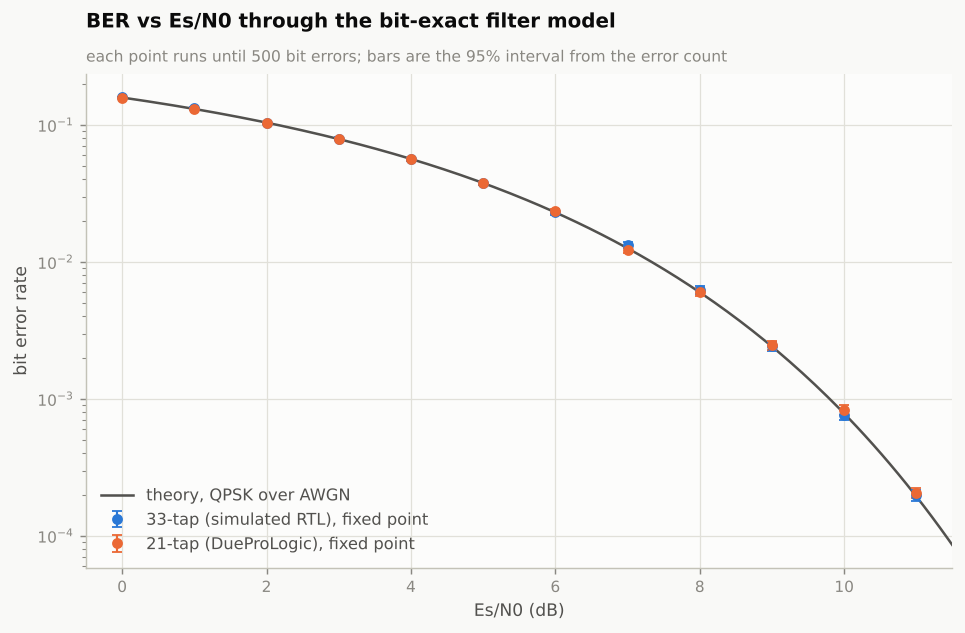
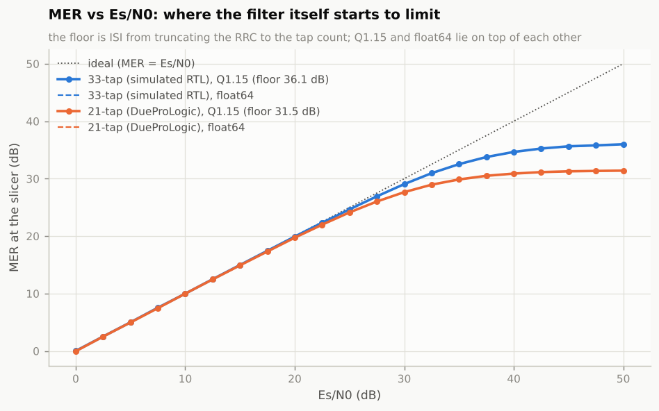
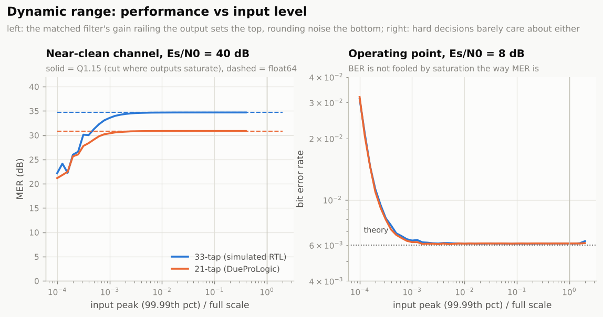
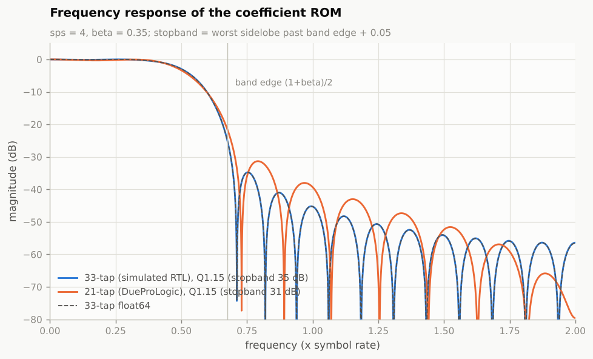

# Performance and test coverage

How well the filter works as a matched filter, what fixed point costs, how
far the input level can move, what the hardware does, and how much of the
design the tests actually exercise.

Every number on the signal side comes from the bit-exact golden model
(`python/golden_model.py`). That is a fair stand-in for the hardware because
the RTL matches it word for word in simulation (330k beats in the regression
below), and the board matches it word for word too (16,384 of 16,384 samples).
Reproduce everything with:

```bash
python python/perf_analysis.py     # figures + docs/perf_results.json, about 30 s
python sim/run_regress.py          # 46 RTL simulations in parallel, about 3 min
python python/board_suite.py --port COM14   # on the board, about a minute
```

## Summary

| | 33-tap (simulated RTL) | 21-tap (DueProLogic) |
|---|---|---|
| BER vs theoretical QPSK, 0 to 11 dB Es/N0 | within the statistical spread at every point | same |
| Fixed-point loss (MER, Q1.15 vs float64) | 0.01 dB at most, 0 to 50 dB Es/N0 | under 0.001 dB |
| Clean-channel MER floor (ISI from truncation) | 36.1 dB | 31.5 dB |
| Stopband attenuation | 34.8 dB | 31.3 dB |
| Input range with BER within 10% of theory (8 dB) | over 70 dB (6e-4 to 2x full scale) | same |
| Input range with MER within 1 dB of float (40 dB) | 50 dB (1.3e-3 to 0.4 of full scale) | 54 dB |
| Hardware | not built (14k LEs, too big for the EP4CE6) | bit-exact, BER 0.0059 vs 0.0060 theory |

The short version: the filter is a matched filter to within what Monte
Carlo can resolve, Q1.15 costs nothing measurable, and the only thing that
separates the board build from the full design is the shorter filter, which
only shows up above about 20 dB Es/N0.

## 1. Bit error rate



Each point keeps adding 65,536-symbol blocks until it has at least 500 bit
errors, up to 2.6 million bits at 11 dB. Across 24 points the measured BER
sits on the theoretical curve `Q(sqrt(Es/N0))`, with ratios between 0.98x and
1.06x. With 500 to 20,000 errors per point the one-sigma spread is 0.7% to
4.5%, so those ratios are consistent with an exactly matched filter. The
largest deviation, 1.06x at 7 dB on the 33-tap build, is 2.5 sigma, about
what you'd expect to see once in 24 points.

The fixed-point and float64 filters make the same decisions on the same
samples: their bit-error counts differ by at most two in any of the 24 runs, out of
hundreds to tens of thousands.

## 2. MER and the filter's own floor



MER at the slicer tracks Es/N0 one for one until the filter's own error
takes over. That floor is inter-symbol interference from cutting the RRC
off at 8 or 5 symbols, not fixed point: the float64 filter fed the same
samples has the same floor (36.13 vs 36.14 dB, 31.46 vs 31.46 dB).

What it means in practice:

- Up to about 20 dB Es/N0 both filters are indistinguishable from ideal.
  QPSK only needs 10 dB or so for a BER of 1e-3, so neither build is close
  to its limit at any useful operating point.
- The 21-tap board build loses 0.5 dB of MER at 22.5 dB Es/N0 and 0.9 dB
  at 25 dB. The 33-tap build loses 0.35 dB at 25 dB and 1 dB at 30 dB. That only matters for higher-order modulation (16-QAM and up) on a
  clean link. If that ever comes up, more taps buy it back, not more bits.
- Moving the Q1.15 coefficients to 18 bits would gain nothing measurable.

## 3. Dynamic range



The input level is swept from 1e-4 of full scale to twice full scale. The
x axis is the 99.99th-percentile input magnitude, which is what
`gen_stimulus.py` normalises to.

- **At the operating point (8 dB)** the BER stays within 10% of theory from
  6e-4 of full scale, where the peak input is about 20 LSB, all the way up
  to 2x full scale, where a third of the outputs are railed. That is over
  70 dB. QPSK decisions depend only on sign, so saturation barely costs
  anything. The filter would tolerate an AGC that is off by a factor of
  1000.
- **On a near-clean channel (40 dB)** the output saturates once the input
  peak passes about 0.5 of full scale. That is the matched filter's gain:
  it concentrates each pulse's energy, so the output peak is roughly twice
  the input peak. `gen_stimulus.py` already backs the scale off for this
  (`--out-headroom`). At the bottom, rounding noise costs 1 dB of MER at
  about 1e-3 of full scale (about 40 LSB of peak input).
- MER by itself is misleading under saturation. A railed output slices to a
  perfect constellation point, so MER goes up while the information is
  being destroyed. That is why the left panel cuts the curve where outputs
  start to rail, and why the right panel uses BER instead.

## 4. Frequency response



The Q1.15 response lies on top of the float64 one: quantising the taps
changes the worst sidelobe by less than 0.1 dB. The stopband (34.8 dB for 33
taps, 31.3 dB for 21) is set by the span, the same truncation that sets the
MER floor. That stopband is also how much an adjacent channel at the same
power gets rejected.

## 5. Hardware

### Board run (2026-10-31)

| | Result |
|---|---|
| Samples through the board | 16,384 of 16,384 bit-exact against the golden model |
| I-channel BER, Es/N0 = 8 dB | 0.0059 (24 errors in 4,090 bits), theory 0.0060 |
| I-channel EVM | 40.03%, theory for this Es/N0 39.8% |
| Link rate | 990 samples/s |
| Fmax (Quartus timing analysis) | 156.5 MHz against a 66 MHz board clock |
| Logic | 5,439 of 6,272 LEs (87%) |

The per-axis theoretical EVM is `sqrt(1 / (Es/N0))` = 39.8% at 8 dB, so the
board's 40.03% is the channel noise and nothing else.

### Where the throughput goes

| Stage | Rate |
|---|---|
| Filter core on the board clock | 66 Msamples/s (one per clock) |
| Filter core at Fmax | 156 Msamples/s |
| UART at 115200 baud, full duplex, 4 bytes per sample each way | 2,880 samples/s |
| Same, lockstep (send, then wait for the reply) | 1,440 samples/s |
| Measured, lockstep with the FTDI latency timer at 1 ms | 990 samples/s |

The link is about 66,000x slower than the filter. Lockstep halves the
UART's ceiling, and the measured 1.01 ms per sample is consistent with the
FT2232H's 1 ms latency timer adding a USB turnaround to every sample. That
is also why the default 16 ms timer gives about 60 samples/s. The host
protocol is the bottleneck, not the filter.

### What the board tests do not cover yet

Every board sample so far arrives thousands of clocks after the previous
one. The delay line moves only on `sample_en`, and the pipeline sits idle in
between. So silicon has proven the arithmetic but not back-to-back
operation at clock rate. Static timing analysis says it has 2.4x of margin
there, but nothing has measured it. An on-chip self-test would close that
gap: an LFSR feeding the filter one sample per clock at 66 MHz, a CRC over
the outputs, and the host comparing the CRC against Python. That fits in
the 833 LEs that are left.

## 6. Simulation coverage

`python sim/run_regress.py` runs the AXI4-Stream testbench (random TREADY
and TVALID stress, protocol checker, latency assertion, bit-exact compare)
over this matrix, four at a time:

| Runs | What |
|---|---|
| 36 | QPSK, {33, 21} taps x Es/N0 {0, 4, 8, 12, 20, 40} dB x 3 noise seeds, each with its own back-pressure seed |
| 2 | corner pattern: both rails, fastest swing, impulses, +/-1 LSB |
| 2 | impulse: the whole output must be the negated coefficient ROM after each -1.0 impulse and 0 between them (closed form, no golden model) |
| 2 | step: every output sample of every held level from the running tap sum, clamped (closed form) |
| 2 | random full-scale words, rails over-weighted, saturating in both directions |
| 2 | the case-statement coefficient ROM |

Latest run: 46 of 46 pass, 330,979 beats through the RTL, all bit-exact, under
234,705 back-pressure stall cycles, with 4,902 saturating outputs and 40
closed-form impulse/step/random responses checked, in 158 s on 4 cores.

### Mutation check

A test suite is only as good as the bugs it catches. Each of these bugs was
put into a copy of the RTL and the quick regression (`--quick`, 14 runs)
was run against it:

| Bug | Runs that failed |
|---|---|
| Rounding removed (`acc + 2^14` becomes `acc`) | 12 of 14. Impulses are exact without rounding, so those two pass, as they should |
| Saturation removed (wraps instead) | 6 of 14: every run that drives the output to a rail |
| Positive rail off by one (32766) | 6 of 14 |
| The AXI wrapper's "obvious" single enable (`pipe_advance = tvalid & tready`) | 14 of 14 |
| I and Q swapped on the output | 14 of 14 |

All five are caught. The closed-form impulse and step checks were also
checked by corrupting single words of the output at different positions.
Every corruption failed the check.

## 7. Board test suite

`python/board_suite.py` runs a set of stimuli through the board with
`dpl_host.py` and checks each one bit for bit. It uses the 21-tap
coefficients and refuses to run if they don't match
`hw_demo/data/rrc_coeffs.hex`, the file the flashed build was compiled from.

| Set | What it shows |
|---|---|
| `qpsk_es0` .. `qpsk_es12` | BER and EVM against theory at 0, 4, 8 and 12 dB, 8,192 samples each |
| `corner` | rails, fastest swing, impulses, +/-1 LSB on silicon |
| `impulse` | each -1.0 impulse returns the negated ROM, checked without the golden model |
| `step` | full-scale steps into saturation |
| `random` | 4,096 full-scale random words, saturating both ways |
| `repeat` | `qpsk_es8` again, must match the first pass exactly (the clear really clears) |
| `soak` | optional, `--soak 100000` for a long random run |

```bash
python python/gen_stimulus.py --span 5 --outdir hw_demo/data   # only if hw_demo/data is gone
python python/board_suite.py --port COM14
python python/board_suite.py --port COM14 --soak 100000        # adds ~100 s
```

It prints a Markdown table and writes `hw_demo/suite/board_summary.json`.
The suite was tested against a software model of the board's byte protocol,
including one with a single corrupted output word, which it reported as a
failure.
